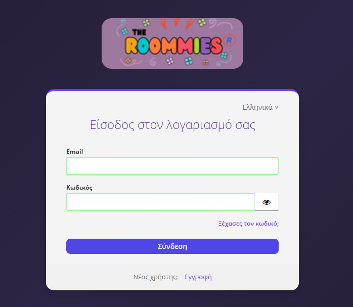
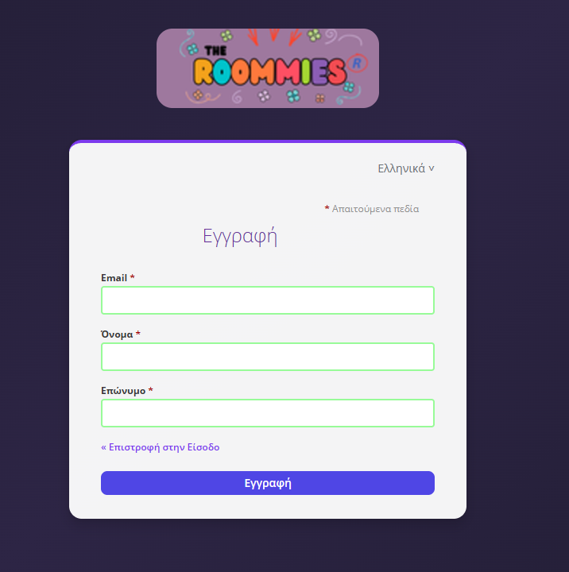
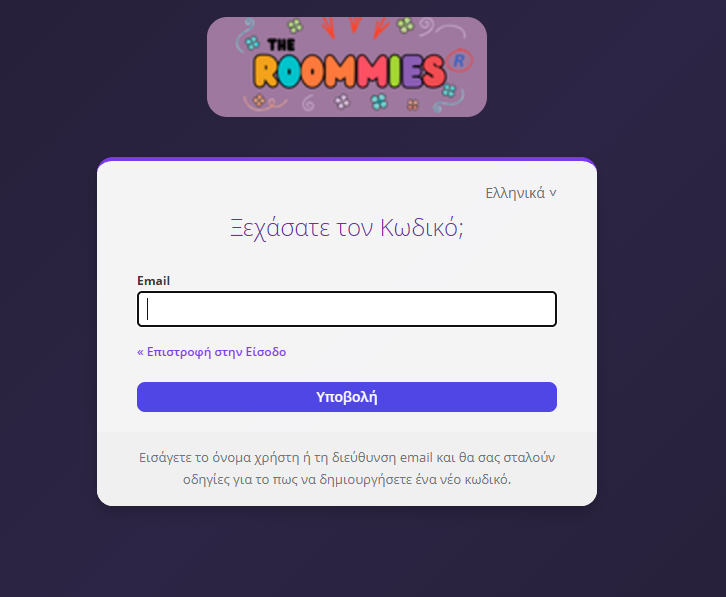

# Roomies Keycloak Login Theme

Custom Keycloak login theme for [The Roommies](https://www.theroommies.gr). A shared-housing management PWA.

CSS-only override of the default Keycloak theme with Roomies branding, responsive design, and Greek locale support.

## Screenshots

| Login | Register | Forgot Password |
|-------|----------|-----------------|
|  |  |  |

## What's Customized

- **Background** ➤ Dark purple gradient matching the app theme
- **Logo** ➤ Roomies branding replacing default Keycloak logo
- **Card** ➤ Purple top border, rounded corners
- **Button** ➤ Indigo primary button
- **Inputs** ➤ Green accent borders
- **Links** ➤ Purple color scheme
- **Greek locale** ➤ Correct translations (replaces broken default "Υποτάσσομαι" ➤ "Σύνδεση")
- **Mobile responsive**

## Structure

```
roomies/
└── login/
    ├── theme.properties
    ├── messages/
    │   └── messages_el.properties
    └── resources/
        ├── css/
        │   └── custom.css
        └── images/
            └── roomies.png
```

## Deployment

1. Upload theme to Keycloak server:
```bash
scp -r roomies/ user@server:/path/to/keycloak-stack/themes/roomies
```

2. Mount in `docker-compose.yml`:
```yaml
volumes:
  - ./themes/roomies:/opt/keycloak/themes/roomies:ro
```

3. Restart Keycloak:
```bash
docker compose restart keycloak
```

4. Keycloak Admin → Realm Settings → Themes → Login Theme → `roomies`

5. Enable internationalization: Realm Settings → Localization → Enabled → Add Greek + English

## Editing

1. Edit files locally
2. Upload with `scp`
3. `docker compose restart keycloak` (restart clears theme cache)
4. Test in incognito

## Tech

- **Keycloak 26.7.5**
- **CSS-only** override (parent theme: `keycloak`)
- **No FreeMarker templates** :  Keycloak 26+ uses CSS theming
- **PatternFly v4** base styles inherited from parent


## Related Repositories

- **Frontend** ➤ [roomies-frontend-React](https://github.com/grgks/roomies-frontend-React) (React / TypeScript / Vite)
- **Backend** ➤ Private repository (available upon request)

## License

This theme is built exclusively for [The Roommies](https://www.theroommies.gr).
It is shared publicly for educational and portfolio purposes only. The Roomies logo and branding are not licensed for reuse.

For questions or feedback, feel free to reach out via [LinkedIn](https://www.linkedin.com/in/giorgos-k-dev).